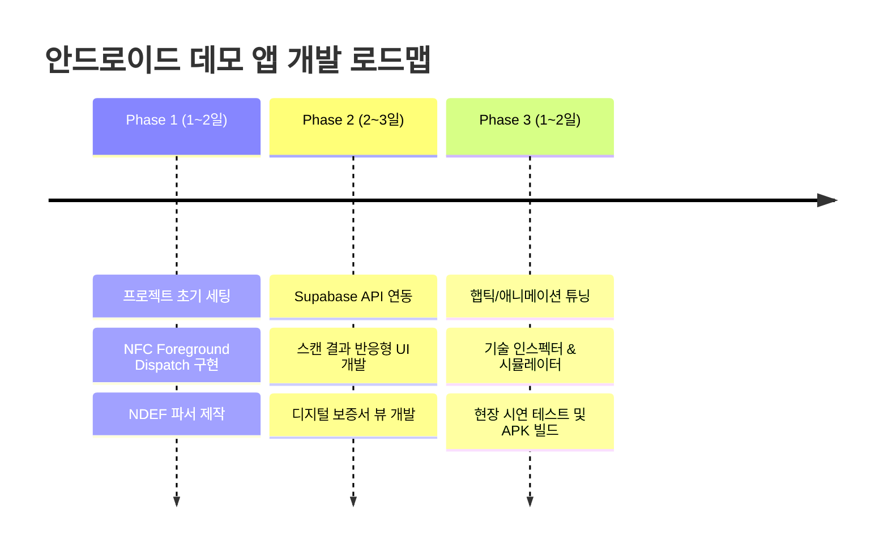

# NFC 정품 인증 안드로이드 데모 앱 기획서

## 1. 기획 배경 및 목적

### 1.1 배경
현재 NXP NTAG 424 DNA 및 JavaCard 기반의 대칭키(AES-128-CMAC) 동적 서명 검증 백엔드(Supabase Edge Function)와 웹 화면이 구축되어 있습니다. 
그러나 모바일 브라우저를 통한 시연은 주소창 노출, 브라우저 캐시, 햅틱/네이티브 효과 부족 등으로 인해 **투자자 IR, 바이어 미팅, 전시회 부스 시연**에서 전문적인 기술 신뢰감과 감성 품질을 전달하는 데 한계가 있습니다.

### 1.2 목적
- **직관적인 보안성 체감**: "탭할 때마다 암호 서명이 바뀌고, 복제 카드는 즉시 차단된다"는 핵심 원리를 3초 안에 시각적·촉각적으로 이해할 수 있는 **네이티브 안드로이드 데모 애플리케이션**을 구축합니다.
- **바이어 및 VIP용 프리미엄 UX**: 럭셔리 브랜드의 정품 보증서 언락 애니메이션 및 햅틱 피드백을 통해 고급스러운 사용자 경험을 제공합니다.
- **엔지니어/기술 검증 지원**: NDEF Raw 데이터(UID, Counter, CMAC) 및 서버 응답 지연 시간(ms)을 즉석에서 검증할 수 있는 인스펙터 기능을 내장합니다.

---

## 2. 타겟 사용자 및 시연 시나리오

```mermaid
flowchart TD
    subgraph Scenario1 ["시나리오 1: 정상 정품 태깅"]
        A1["정품 NFC 카드 태깅"] --> B1["햅틱 진동 & 펄스 효과"]
        B1 --> C1["서버 실시간 암호 검증 (0.1초)"]
        C1 --> D1["🟢 골드/에메랄드 정품 인증 완료"]
        D1 --> E1["디지털 정품 보증서 열람"]
    end

    subgraph Scenario2 ["시나리오 2: 복제 태그 시연 (리플레이 공격)"]
        A2["이전 태깅 URL 또는 카피본 탭"] --> B2["보안 카운터 비교"]
        B2 --> C2["카운터 중복/역전 감지"]
        C2 --> D2["🟠 주황색 복제 의심 경고 화면"]
    end

    subgraph Scenario3 ["시나리오 3: 위조 태그 시연"]
        A3["임의 키로 구워진 가짜 카드 탭"] --> B3["CMAC 서명 검증 실패"]
        B3 --> C3["🔴 빨간색 위조품 차단 경고 화면"]
    end
```



---

## 3. 핵심 기능 명세 (Feature Specifications)

| 기능 ID | 기능명 | 상세 내용 | 비고 |
| :--- | :--- | :--- | :--- |
| **F-01** | **포그라운드 NFC 인터셉트** | 앱이 켜진 상태에서 태그를 탭하면 웹 브라우저가 열리지 않고 앱 내부에서 즉시 NDEF를 가로채어 파싱 | `ForegroundDispatch` 사용 |
| **F-02** | **동적 파라미터 자동 추출** | NDEF URI 레코드에서 `uid`(14자리), `cnt`(6자리/12자리), `mac`(16자리), `kid`를 정규식으로 안전하게 분리 | 3B/6B 카운터 호환 |
| **F-03** | **Supabase API 실시간 검증** | 추출된 파라미터를 Supabase Edge Function에 비동기 전달 (`format=json`), 검증 속도(Latency ms) 측정 | 타임아웃 3초 |
| **F-04** | **상태별 비주얼 결과 연출** | • **정품 완료 (AUTHENTIC)**: 럭셔리 카드 회전 애니메이션, 정품 배지, 인증 카운터<br/>• **복제 경고 (REPLAY)**: 카운터 재사용 안내, 경고 펄스<br/>• **위조 경고 (TAMPERED)**: 서명 불일치 경고<br/>• **미등록 (UNREGISTERED)**: 등록되지 않은 태그 안내 | 햅틱 피드백 연동 |
| **F-05** | **디지털 정품 보증서 뷰** | 정품 인증 성공 시 모바일 네이티브 카드 형태의 디지털 보증서(발급일, 보증기간, 시리얼, 제품 스펙) 화면 표시 | 네이티브 모달 |
| **F-06** | **시연자용 Raw 데이터 인스펙터** | 카드 뒷면의 원시 Hex 데이터(UID, Counter Hex, CMAC, API 응답 시간 ms, 세션 키 유도 정보)를 슬라이드업 시트로 표시 | 기술 미팅/QA용 |
| **F-07** | **실시간 스캔 히스토리** | 연속 탭 시 증가하는 카운터(`#61 -> #62 -> #63`)와 매번 달라지는 MAC 값을 실시간 리스트로 비교 시각화 | 동적 서명 증명용 |
| **F-08** | **가상 태그 시뮬레이터 (Mock)** | 실제 물리 카드가 없거나 발표 슬라이드 진행 시, 버튼 클릭만으로 정품/복제/위조 시나리오를 즉석 재현 | 데모 전용 |

---

## 4. 화면 설계 (Screen Flow & Wireframe)

```
[1. 메인 스캐너 화면] ──(NFC 탭)──► [2. 실시간 검증 로딩 (0.1s)] ──► [3. 결과 카드 팝업]
        │                                                                   │
        ├── [4. 스캔 히스토리 탭]                                            ├── [5. 디지털 정품 보증서]
        └── [6. 가상 시뮬레이터 탭]                                          └── [7. Raw 데이터 인스펙터]
```

### 4.1 메인 스캐너 화면 (Main Scanner)
- **중앙**: 부드럽게 고동치는(pulsing) 레이더/NFC 카드 형상의 애니메이션 원형 링
- **안내 문구**: `"NFC 카드를 스마트폰 뒷면에 태깅하세요"`
- **상태 인디케이터**: 서버 연결 상태 (🟢 Supabase Live / 지연시간 표시)
- **하단 네비게이션**: `[스캔]`, `[히스토리]`, `[시뮬레이터]`, `[설정]`

### 4.2 결과 카드 팝업 (Verification BottomSheet / Dialog)
- **정품 인증 성공 (AUTHENTIC)**:
  - 🟢 에메랄드/골드 테마
  - 카드 상단: 골드 메달 체크 애니메이션 + 성공 사운드/성공 햅틱 진동
  - 본문: 브랜드 로고, 제품명 (`NTAG-424-DNA-PoC`), 시리얼 번호 (`ORCA-TEST-0001`)
  - 메타데이터: `"고객님이 5번째로 인증하셨습니다"`, 최초 인증 일시
  - 하단 버튼: `[디지털 보증서 보기]`, `[기술 데이터 확인]`
- **복제 의심 경고 (REPLAY ATTACK)**:
  - 🟠 앰버(주황색) 테마 + 주의 햅틱 진동
  - `"⚠️ 복제 의심 태그 경고 (재전송 감지)"`
  - `"이전에 이미 인증된 카운터(#61)가 다시 수신되었습니다. 복제된 카드이거나 복사된 URL입니다."`
- **위조품 경고 (TAMPERED)**:
  - 🔴 크림슨(빨간색) 테마 + 경고 햅틱 진동
  - `"⛔ 위조품 의심 경고"`
  - `"암호화 서명(CMAC)이 올바르지 않습니다. 비정상 복제본입니다."`

### 4.3 디지털 정품 보증서 화면 (Digital Certificate View)
- 프리미엄 홀로그램 질감의 디지털 카드 뷰
- 제품 고유 이미지, 소유자 정보, 제조사 공식 인증 서명, 타임스탬프 정보

### 4.4 시연자용 기술 인스펙터 (Technical Inspector Modal)
- `UID`: `04:DE:5F:1E:AC:C0:40` (7 Bytes)
- `Counter`: `61` (Raw Hex: `0x00003D`)
- `Received MAC`: `94EED9EE65337086` (8 Bytes Truncated CMAC)
- `Server Latency`: `124 ms`
- `Key Index`: `#1`

---

## 5. 기술 스택 및 아키텍처

```
┌────────────────────────────────────────────────────────┐
│                   UI Layer (Jetpack Compose)           │
│    - ScannerScreen  - ResultSheet  - CertificateScreen │
└───────────────────────────▲────────────────────────────┘
                            │ (UI State / StateFlow)
┌───────────────────────────┴────────────────────────────┐
│                    ViewModel Layer                     │
│    - ScanViewModel  - HistoryViewModel  - MockViewModel│
└───────────────────────────▲────────────────────────────┘
                            │
┌───────────────────────────┴────────────────────────────┐
│                   Domain / UseCase                     │
│    - VerifyNfcTagUseCase   - ParseNdefUrlUseCase        │
└───────────────────────────▲────────────────────────────┘
                            │
┌───────────────────────────┴────────────────────────────┐
│                   Data / Repository                    │
│    - NfcRepository (Supabase API + Retrofit/OkHttp)    │
│    - HistoryRepository (Room Database)                 │
│    - NfcManager (Android NfcAdapter ForegroundDispatch)│
└───────────────────────────▲────────────────────────────┘
```

| 레이어 | 기술 스택 | 선정 사유 |
| :--- | :--- | :--- |
| **언어** | **Kotlin 2.x** | 최신 안드로이드 표준 언어, Coroutines / Flow 지원 |
| **UI 프레임워크** | **Jetpack Compose** | 선언형 UI, 부드러운 상태 전환 애니메이션, 최신 머티리얼 3 디자인 |
| **비동기 처리** | **Coroutines + Flow** | 초저지연 비동기 처리 및 반응형 상태 관리 |
| **NFC 제어** | **Android `NfcAdapter`** | `enableForegroundDispatch`로 시스템 기본 브라우저 실행 차단 및 내부 인터셉트 |
| **네트워킹** | **Retrofit 2 + OkHttp 3** | Supabase Edge Function API 통신, 로깅 인터셉터로 통신 패킷 실시간 확인 |
| **로컬 DB** | **Room DB** | 스캔 히스토리 저장 및 오프라인 캐싱 |
| **디자인 시스템** | **Material 3 (M3)** | 다크 모드 기본 적용 (전시회/어두운 조명에서 시인성 극대화) |

---

## 6. 개발 단계 및 일정 계획 (3단계 로드맵)



### Phase 1: 기반 아키텍처 및 NFC 인터셉터 구축
- 안드로이드 스튜디오 프로젝트 생성 (Package: `com.orca.nfcauth`)
- `NfcAdapter` Foreground Dispatch 구현 (앱 구동 중 태깅 시 브라우저 방지)
- NDEF URL 파서 유틸리티 개발 (`uid`, `cnt`, `mac`, `kid` 파싱)

### Phase 2: Supabase 연동 및 핵심 UI 개발
- Retrofit2 API 클라이언트 구축 (`GET /functions/v1/nfc?format=json`)
- Compose 기반 메인 스캐너 뷰 및 상태별 결과 카드(성공/복제/위조) 컴포넌트 개발
- 디지털 정품 보증서 뷰 연동

### Phase 3: 데모 최적화 및 시연 도구 완성
- 시연자용 기술 인스펙터(Raw 데이터 보기) 패널 추가
- 가상 카드 시뮬레이터(물리 카드 없이 원클릭 시연) 모드 추가
- 햅틱 피드백(진동 패턴) 및 60fps 마이크로 애니메이션 적용
- 릴리즈 APK 빌드 및 실기기 필드 테스트
