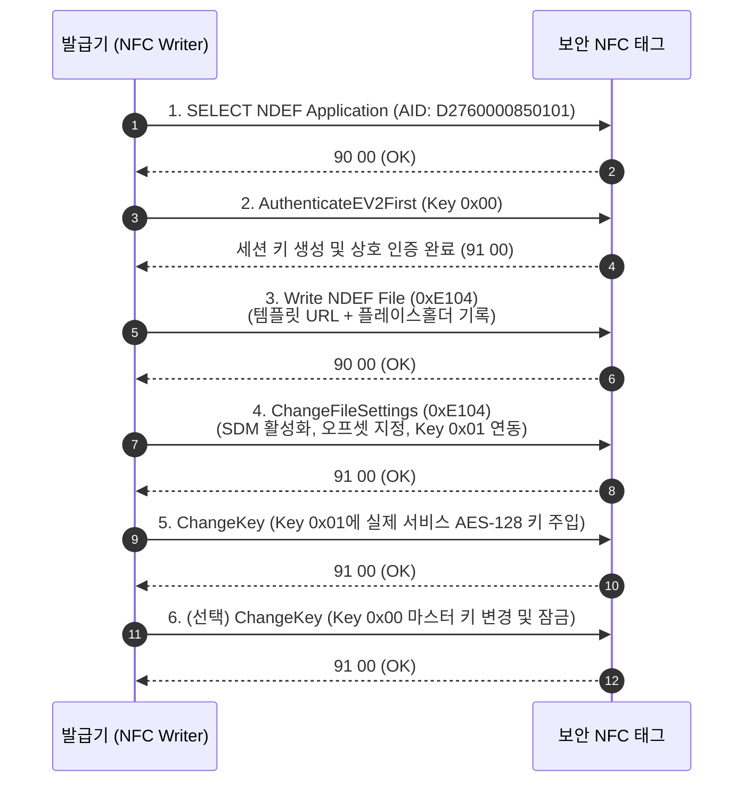

# NFC Authentication 발급 및 개발자 가이드 (NDEF & SDM 미러링 규격)

본 문서는 **NFC Authentication 보안 태그**를 발급(Personalization)하고, 서버(`https://xxx.co/v1/nfc`)와 연동하기 위해 NFC 태그 내부 NDEF 레코드 및 SDM(Secure Dynamic Messaging) 설정을 구성하는 NFC 개발자/발급 담당자용 기술 가이드입니다.

---

## 1. 하드웨어 및 암호화 요구 사양

| 항목 | 규격 사양 | 비고 |
| :--- | :--- | :--- |
| **태그 칩셋** | **Type 4 NFC 보안 암호화 태그** | ISO/IEC 14443-A, Type 4 Tag |
| **NDEF 파일 ID** | File `0x02` (EF `0xE104`) | 기본 NDEF 저장 파일 |
| **암호화 알고리즘** | **AES-128 (대칭키)** | NIST SP 800-38B CMAC |
| **통신 모드** | **CommMode.PLAIN (SDM Mirroring)** | 스마트폰 기본 브라우저 열기용 |
| **미러링 모드** | **Plain UID + Plain Counter + SDMMAC** | NIST SP 800-38B CMAC 기준 |

---

## 2. NDEF URL 템플릿 및 파라미터 규격

스마트폰 탭 시 보안 NFC 칩이 동적으로 URL 내의 플레이스홀더(`00...00`)를 실제 데이터로 치환합니다.

### 2.1 작성할 기본 NDEF URL 템플릿
```text
https://xxx.co/v1/nfc?uid=00000000000000&cnt=000000&mac=0000000000000000&kid=1
```

### 2.2 파라미터별 오프셋 및 길이 설정값

| 파라미터 | 데이터 내용 | 할당 길이 (Hex 문자) | 바이트 크기 | 설명 |
| :--- | :--- | :---: | :---: | :--- |
| **`uid`** | 태그 고유 UID | **14자리** (`00000000000000`) | 7 Bytes | 칩 내부 고유 일련번호가 ASCII Hex로 치환됨 |
| **`cnt`** | 보안 탭 카운터 | **6자리** (`000000`) | **3 Bytes** | 탭할 때마다 1씩 증가하는 Big-Endian 카운터 (예: `000001`, `00003D`) |
| **`mac`** | 암호화 서명 (CMAC) | **16자리** (`0000000000000000`) | 8 Bytes | 칩 내부에서 계산된 8바이트 Truncated CMAC (`MACt`) |
| **`kid`** | 키 인덱스 (선택) | 고정값 (예: `1`, `2`) | - | 서버 DB에 등록된 키 번호 (여러 키 운영 시 유용) |

> [!NOTE]
> **카운터 엔디언 규격**:
> 서버는 NFC Authentication 태그에서 URL로 전달되는 3바이트 카운터를 **Big-Endian(예: 000001, 00003D)** 규격으로 처리합니다.

---

## 3. NFC 보안 태그 키 구조 (Application Keys)

보안 NFC 태그는 5개의 AES-128 키(Key 0x00 ~ 0x04)를 지원합니다:

| 키 번호 | 키 명칭 | 권장 설정 용도 | 서버 연동 여부 |
| :---: | :--- | :--- | :---: |
| **Key 0x00** | **App Master Key** | 태그 설정 변경 및 키 교체 전용 마스터 키 | ❌ (발급용 보관) |
| **Key 0x01** | **SDMFileReadKey** | **SDM 세션키 생성 및 CMAC 계산 키** | ✅ **서버 DB에 암호화 보관** |
| **Key 0x02** | **SDMMetaReadKey** | PICCData 암호화용 (평문 미러링 시 미사용) | 선택 |
| **Key 0x03** | **Proprietary Key**| 비공개 데이터 파일 접근용 (필요 시) | 선택 |

---

## 4. 태그 발급(Personalization) 절차

태그 발급 소프트웨어 또는 공장 프로그래머에서 다음 APDU 시퀀스를 실행합니다.



### 4.1 핵심 설정: `ChangeFileSettings` (File 0x02) 파라미터 값
- **FileOption**: `0x40` (SDM 및 미러링 활성화, CommMode.PLAIN)
- **AccessRights**: `0x00E0` (Read: Free 0xE, Write: Key 0x00)
- **SDMOptions**:
  - Bit 7 (UID Mirror): `1` (활성화)
  - Bit 6 (SDMReadCtr Mirror): `1` (활성화)
  - Bit 0 (ASCII Encoding Mode): `1` (ASCII Hex 문자열로 미러링)
  - 값: `0xC1`
- **SDMAccessRights**:
  - `FileAR.SDMFileRead`: `0x1` (Key 0x01을 CMAC 계산 키로 지정)
  - `FileAR.SDMMetaRead`: `0xE` (평문 미러링이므로 암호화 불필요 시 0xE)
  - `FileAR.SDMCtrRet`: `0x1`
- **오프셋 설정**:
  - `UIDOffset`: URL 내 `uid=` 바로 다음 위치의 오프셋
  - `SDMReadCtrOffset`: URL 내 `cnt=` 바로 다음 위치의 오프셋
  - `SDMMACOffset`: URL 내 `mac=` 바로 다음 위치의 오프셋
  - `SDMMACInputOffset`: CMAC 입력 시작 위치 (일반적으로 `SDMMACOffset`과 동일하게 지정하여 zero-length input 설정)

---

## 5. 발급 완료 후 서버 DB 등록 방법

태그를 발급한 뒤, 사용된 Key와 UID를 서버 DB에 등록해야 정품 인증이 정상 처리됩니다.

### 5.1 Step 1: 사용된 AES-128 키를 DB에 등록 (최초 1회 또는 키 변경 시)
```powershell
# 예시: Key 0x01로 'A1B2C3D4E5F60102030405060708090A'를 사용한 경우
node scripts/manage_keys.js encrypt --index 1 --name "2026 정품 라벨 배치 #1" --key A1B2C3D4E5F60102030405060708090A
```
👉 출력되는 `INSERT INTO public.nfc_keys ...` SQL을 Supabase **SQL Editor**에서 실행합니다. (DB에는 AES-256-GCM으로 암호화되어 안전하게 저장됩니다.)

### 5.2 Step 2: 발급된 태그 UID 등록
```sql
INSERT INTO public.nfc_tags (uid, tag_name, key_index, last_counter, status, product_info)
VALUES (
    '04A1B2C3D4E5F6',                 -- 발급된 태그의 14자리 UID (소문자)
    '2026 한정판 프리미엄 상품',
    1,                                -- 위에서 등록한 key_index
    0,                                -- 초기 카운터
    'ACTIVE',
    '{
        "brand": "MyBrand",
        "model": "Model-X",
        "serialNumber": "SN-2026-0001",
        "supportUrl": "https://xxx.co/support"
    }'::jsonb
);
```

---

## 6. NFC 모바일 앱(NFC Tools Pro 등) 테스트 설정 팁
- PC 프로그래머 대신 **NFC 프로그래밍 스마트폰 앱**(예: NFC Tools Pro 등)으로 PoC 테스트를 진행할 경우:
  1. `Write` $\rightarrow$ `New dataset` $\rightarrow$ `Link` 선택
  2. URI 타입 선택 후 URL 입력:
     `https://xxx.co/v1/nfc?uid=00000000000000&cnt=000000&mac=0000000000000000&kid=1`
  3. `Advanced settings` / `Mirroring` 활성화:
     - Mirror UID: 체크
     - Mirror Interaction Counter: 체크
     - SDM / SUN 활성화
     - Key 1을 Read Key로 지정
