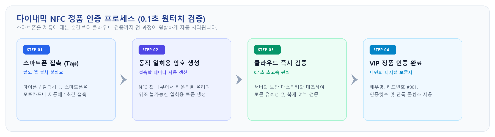
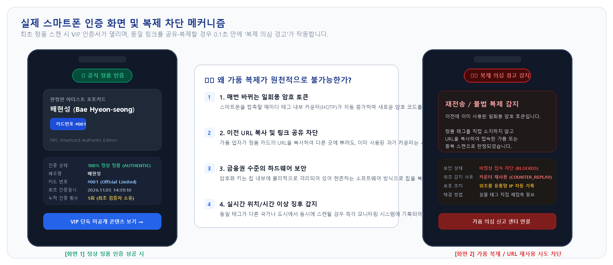

# 차세대 NFC 정품 인증 솔루션 소개서

> **"스마트폰 탭 한 번으로 증명되는 100% 정품의 가치"**  
> 별도의 앱 설치 없이, 스마트폰을 가져다 대는 것만으로 위조가 불가능한 정품 인증과 브랜드 독점 경험을 제공합니다.

---

## 1. 솔루션 개요 (Executive Summary)

전 세계적인 위조품 시장의 급성장과 교묘해진 가품 유통으로 인해, 브랜드와 팬덤(소비자) 모두 심각한 신뢰 위협을 겪고 있습니다. 기존의 홀로그램 스티커나 QR코드는 스마트폰 카메라로 사진을 찍거나 인쇄하는 것만으로 손쉽게 복제되어 근본적인 해결책이 되지 못했습니다.

본 **다이내믹 NFC 정품 인증 솔루션**은 금융권 OTP 및 스마트카드 보안 규격(RFC 4226 HOTP)을 물리 제품에 적용한 차세대 솔루션입니다. 제품에 내장된 스마트 태그는 **스마트폰과 접촉할 때마다 매번 다른 일회용 암호화 토큰을 생성**하므로, 링크를 복사하거나 카드를 복제해도 가품을 절대 만들 수 없습니다.

### 4단계 인증 프로세스 (0.1초 원터치 검증)

---

## 2. 기존 인증 방식과의 차이점 (Why Dynamic NFC?)

| 비교 항목 | 기존 QR코드 / 바코드 | 기존 홀로그램 스티커 | **본 NFC 정품 인증 솔루션** |
| :--- | :--- | :--- | :--- |
| **복제 방지 능력** | **취약** (사진 촬영 및 인쇄 복제 가능) | **보통** (정밀 인쇄로 유사 위조 가능) | **완벽 방어 (매 탭마다 일회용 암호 생성, 복제 원천 불가)** |
| **사용자 접근성** | 카메라 켜기 → 초점 맞추기 → 인식 | 육안 확인 (일반인 구별 어려움) | **스마트폰을 제품에 1초 접촉 (Zero-Click 접근)** |
| **앱 설치 필요 여부**| 간혹 전용 리더기/앱 요구 | 불필요 | **불필요 (원클릭 웹 접속 & 전용 앱 전환 지원)** |
| **재전송(복사) 공격** | 링크만 알면 누구나 동일 화면 조회 | 해당 없음 | **이미 사용된 이전 코드는 즉시 차단 및 경고** |
| **디지털 데이터 연계**| 단순 정적 웹페이지 연결에 그침 | 디지털 연동 불가 | **고유 시리얼, 누적 인증 횟수, 실시간 통계 연동** |

---

## 3. 사용자(소비자 / 팬덤) 입장에서의 장점

### 1) 진입 장벽 없는 제로-프릭션 (Zero-Friction)
- **앱 설치 No, 회원가입 No**: App Store나 Google Play에서 낯선 앱을 설치할 필요 없이 스마트폰 기본 브라우저로 1초 만에 실행됩니다.
- **남녀노소 전 세계 팬 누구나 동일한 사용성**: 잠금 해제된 스마트폰을 대기만 하면 언어와 국경에 관계없이 즉각 동작합니다.

### 2) "내 물건은 100% 진짜"라는 절대적 신뢰
- **가품에 대한 불안감 즉각 해소**: 고가의 명품, 한정판 굿즈, 연예인 친필 사인 등을 구매했을 때 느끼는 가품 불안을 0.1초 만에 해소합니다.
- **중고 거래(리셀) 시 즉석 정품 보증**: 스마트폰을 탭하여 구매자에게 눈앞에서 공식 정품임을 명확하게 입증할 수 있습니다.

### 3) 소장 가치와 프리미엄 경험 극대화
- **살아있는 디지털 인증서**: 단순한 플라스틱이나 종이 카드가 아닌, 스마트폰과 상호작용하는 디지털 소장품으로 변모합니다.
- **세상에 단 하나뿐인 나만의 제품**: 카드 번호(예: *#001 한정판*), 배우/아티스트의 이름, 첫 스캔 날짜가 기록되어 소장 가치를 극대화합니다.

### 4) 시크릿 VIP 혜택으로의 연결
- **구매자 전용 독점 콘텐츠**: 정품 인증 완료 시 정품 소유자만 열람할 수 있는 미공개 영상, 시크릿 화보, 팬클럽 단독 혜택으로 매끄럽게 연결됩니다.

### 실제 스마트폰 인증 화면 및 복제 차단 구조

---

## 4. 도입 기업(브랜드 / 기획사) 입장에서의 장점

### 1) 가품 유통 및 브랜드 훼손 100% 원천 방어
- 금융권 암호 알고리즘(RFC 4226)을 적용하여, **복제품 제작 비용이 정품 제작 비용을 초과**하게 만들어 가품 업자의 모조 시도를 원천 차단하고 브랜드 이미지를 보호합니다.

### 2) 오프라인 구매자를 온라인 충성 고객(D2C)으로 전환
- 오프라인 매장, 팝업스토어에서 구매한 익명 고객이 정품 인증을 위해 스마트폰을 탭하는 순간, **브랜드의 공식 온라인몰 회원가입, 멤버십 연동, 프로모션 참여**로 직접 유입시키는 강력한 D2C 마케팅 채널이 열립니다.

### 3) 글로벌 실시간 유통 및 이상 징후 감지 (Data Intelligence)
- 어느 국가, 어느 도시에서 제품이 언제 스캔되었는지 대시보드를 통해 실시간으로 파악합니다.
- 동일 카드가 여러 지역에서 중복 스캔될 경우 **가품 유통 거점을 조기에 탐지하고 법적 조치를 취할 수 있는 데이터 증거**를 확보합니다.

### 4) 기존 제품 공정 및 패키징에 손쉬운 적용
- 스티커(Inlay) 태그, 에폭시 태그, PVC 스마트카드 등 다양한 폼팩터를 지원합니다.
- 기존 의류 라벨, 화장품 패키지, 굿즈 포토카드 등의 **기존 제조 공정을 크게 바꾸지 않고도 간편하게 내장**할 수 있습니다.

### 5) 저비용·고확장성 서버리스(Cloud) 인프라
- 수십만 명이 동시에 몰리는 한정판 출시일에도 서버 다운 없이 즉각 대응하는 글로벌 Edge 네트워크 구조로 구축되어, 불필요한 고정 유지비 없이 사용량 기반으로 합리적 운영이 가능합니다.

---

## 5. 주요 적용 분야 (Use Cases)

| 적용 분야 | 주요 품목 및 활용 예시 | 기대 효과 |
| :--- | :--- | :--- |
| **엔터테인먼트 & K-컬처** | 한정판 포토카드, 콘서트 공식 응원봉, 친필 사인 앨범 | 가품 거래 차단 및 미공개 영상/보이스 독점 제공 |
| **럭셔리 패션 & 스트릿웨어** | 명품 가방, 신발, 의류 라벨, 한정판 스니커즈 변조 방지 씰 | 중고 리셀 거래 시 현장 즉석 정품 판별 도구로 활용 |
| **아트 & 프리미엄 컬렉터블** | 미술품/판화 디지털 보증서(COA), 한정판 피규어, 트레이딩 카드 | 영구적이고 훼손 없는 안전한 디지털 소유권 증명 |
| **프리미엄 뷰티 & 주류 (F&B)** | 프리미엄 기초 화장품 밀봉 패키지, 고급 싱글몰트 위스키/와인 라벨 | 병마개 개봉 시 파손 씰로 내용물 바꿔치기 완벽 방지 |

---

## 6. 라이브 데모 및 도입 문의 안내

* 🌐 **정품 인증 라이브 데모**: [https://nfcauth.vercel.app](https://nfcauth.vercel.app)
* 🔄 **테스트용 카운터 리셋 허브**: [https://nfcauth.vercel.app/reset](https://nfcauth.vercel.app/reset)
* 💡 **정품 인증 즉시 테스트 예시 URL**:
  * [카운터 0번 인증 테스트 (배현성 한정판 포토카드)](https://nfcauth.vercel.app/?DF61100102030405060708090A0B0C0D0E0F10DF6203328482DF6303000000)

> [!NOTE]  
> 맞춤형 브랜딩(자사 UI/UX 적용), CRM/팬클럽 회원 연동, 대량 발급 규격 문의는 기술지원팀으로 문의해 주시기 바랍니다.
