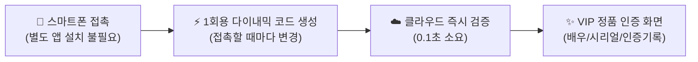
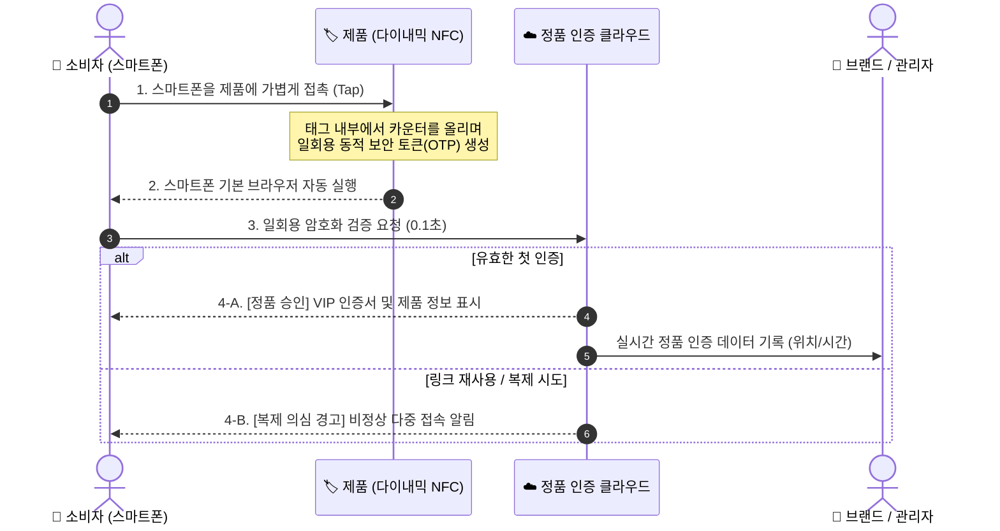

# 차세대 다이내믹 NFC 정품 인증 솔루션 소개서
> **"스마트폰 탭 한 번으로 증명되는 100% 정품의 가치"**  
> 별도의 앱 설치 없이, 스마트폰을 가져다 대는 것만으로 위조가 불가능한 정품 인증과 브랜드 독점 경험을 제공합니다.

---

## 1. 솔루션 개요 (Executive Summary)

전 세계적인 위조품 시장의 급성장과 교묘해진 가품 유통으로 인해, 브랜드와 팬덤(소비자) 모두 심각한 신뢰 위협을 겪고 있습니다. 기존의 홀로그램 스티커나 QR코드는 스마트폰 카메라로 사진을 찍거나 인쇄하는 것만으로 손쉽게 복제되어 근본적인 해결책이 되지 못했습니다.

본 **다이내믹 NFC 정품 인증 솔루션**은 금융권 OTP 및 스마트카드 보안 규격(RFC 4226 HOTP)을 물리 제품에 적용한 차세대 솔루션입니다. 제품에 내장된 스마트 태그는 **스마트폰과 접촉할 때마다 매번 다른 일회용 암호화 토큰을 생성**하므로, 링크를 복사하거나 카드를 복제해도 가품을 절대 만들 수 없습니다.



---

## 2. 기존 인증 방식과의 차이점 (Why Dynamic NFC?)

| 비교 항목 | 기존 QR코드 / 바코드 | 기존 홀로그램 스티커 | **본 다이내믹 NFC 솔루션** |
| :--- | :--- | :--- | :--- |
| **복제 방지 능력** | **취약** (사진 촬영 및 인쇄 복제 가능) | **보통** (정밀 인쇄로 유사 위조 가능) | **완벽 방어 (매 탭마다 암호 변경, 복제 원천 불가)** |
| **사용자 접근성** | 카메라 켜기 → 초점 맞추기 → 인식 | 육안 확인 (일반인 구별 어려움) | **스마트폰을 제품에 1초 접촉 (Zero-Click)** |
| **앱 설치 필요 여부**| 간혹 전용 리더기/앱 요구 | 불필요 | **전혀 불필요 (기본 브라우저 즉시 구동)** |
| **재전송(복사) 공격** | 링크만 알면 누구나 동일 화면 조회 | 해당 없음 | **이미 사용된 이전 코드는 즉시 차단 및 경고** |
| **디지털 데이터 연계**| 정적 웹페이지 연결에 그침 | 디지털 연동 불가 | **고유 시리얼, 인증 횟수, 실시간 통계 연동** |

---

## 3. 기본 인증 흐름 (Authentication Flow)

소비자는 복잡한 절차 없이 일상적인 스마트폰 사용 경험 그대로 정품을 확인합니다.



### 단계별 안내:
1. **가볍게 탭 (Tap)**  
   잠금 해제된 스마트폰(iPhone, Galaxy 등)을 포토카드나 제품 라벨에 1초간 가져다 댑니다.
2. **원클릭 브라우저 오픈**  
   별도의 앱 다운로드나 회원가입 절차 없이, 스마트폰 기본 인터넷 브라우저가 자동으로 열립니다.
3. **0.1초 실시간 정품 검증**  
   서버에서 해당 제품의 고유 키값과 일회용 토큰의 유효성을 0.1초 만에 확인합니다.
4. **프리미엄 인증 결과 확인**  
   정품일 경우 축하 연출과 함께 정품 시리얼 넘버, 인증 횟수, 최초 인증 일시, 한정판 콘텐츠가 펼쳐집니다. 만약 누군가 이전에 사용된 URL을 공유하거나 복제했을 경우 **"복제 의심 경고"**를 즉각 띄워 소비자를 보호합니다.

---

## 4. 사용자(소비자 / 팬덤) 입장에서의 장점

### 1) 진입 장벽 없는 제로-프릭션 (Zero-Friction)
* **앱 설치 No, 회원가입 No**: App Store나 Google Play에서 낯선 앱을 설치할 필요가 없습니다.
* **노인, 어린이, 글로벌 팬 모두 동일한 사용성**: 전 세계 누구나 스마트폰을 대기만 하면 1초 만에 동작합니다.

### 2) "내 물건은 100% 진짜"라는 절대적 신뢰
* 고가의 명품, 한정판 굿즈, 연예인 친필 사인 등을 구매했을 때 느끼는 **가품에 대한 불안감을 즉시 해소**해 줍니다.
* 중고 거래(리셀) 시에도 스마트폰을 탭하여 구매자에게 눈앞에서 정품임을 확실하게 입증할 수 있습니다.

### 3) 소장 가치와 프리미엄 경험 극대화
* 단순한 플라스틱이나 종이 카드가 아닌, **스마트폰과 상호작용하는 살아있는 디지털 인증서**로 변모합니다.
* 제품의 고유 넘버링(예: *#001 한정판*), 배우/아티스트의 이름, 첫 스캔 날짜가 기록되어 **세상에 단 하나뿐인 나만의 제품**이라는 애착을 형성합니다.

### 4) 시크릿 VIP 혜택으로의 연결
* 정품 인증 화면을 통해 정품 소유자만 볼 수 있는 **미공개 영상, 시크릿 화보, 팬클럽 단독 혜택, 보증서 연장 서비스** 등으로 매끄럽게 연결됩니다.

---

## 5. 도입 기업(브랜드 / 기획사) 입장에서의 장점

### 1) 가품 유통 및 브랜드 훼손 100% 원천 방어
* 수학적/암호학적으로 검증된 표준 알고리즘(RFC 4226)을 사용하여, **복제품 제작 비용이 정품 제작 비용을 초과**하게 만들어 가품 업자의 모조 시도를 원천 차단합니다.
* 브랜드의 오랜 명성과 프리미엄 이미지를 침해로부터 완벽하게 보호합니다.

### 2) 오프라인 구매자를 온라인 충성 고객(D2C)으로 전환
* 오프라인 팝업스토어, 리테일 샵, 앨범 판매처에서 제품을 구매한 고객은 대개 익명으로 남습니다.
* 소비자가 정품 인증을 위해 스마트폰을 탭하는 순간, **브랜드의 공식 온라인몰 회원가입, 멤버십 연동, 프로모션 참여**로 직접 유입시키는 강력한 D2C(Direct-to-Consumer) 마케팅 채널이 열립니다.

### 3) 글로벌 실시간 유통 및 이상 징후 감지 (Data Intelligence)
* 어느 국가, 어느 도시에서 제품이 언제 스캔되었는지 대시보드를 통해 실시간으로 파악할 수 있습니다.
* 특정 지역에서 동일한 카드의 비정상적인 스캔이 급증할 경우, **가품 유통 거점을 조기에 탐지하고 법적 조치를 취할 수 있는 데이터 증거**를 확보합니다.

### 4) 기존 제품 공정 및 패키징에 손쉬운 적용
* 얇은 스티커(Inlay) 태그, 에폭시 태그, PVC 스마트카드 등 다양한 폼팩터를 지원합니다.
* 기존 의류의 케어라벨, 신발 밑창, 화장품 단상자, 굿즈 포토카드 등의 **기존 제조 공정을 크게 바꾸지 않고도 간편하게 내장**할 수 있습니다.

### 5) 저비용·고확장성 서버리스(Cloud) 인프라
* 수십만 명이 동시에 접속하는 한정판 출시일에도 서버 다운 없이 즉각 대응하는 글로벌 Edge 네트워크 구조를 갖추고 있습니다.
* 불필요한 고정 서버 비용 없이, 사용량에 맞춘 합리적이고 효율적인 운영이 가능합니다.

---

## 6. 주요 적용 분야 (Use Cases)

```
┌────────────────────────┐  ┌────────────────────────┐
│  엔터테인먼트 & K-컬처  │  │   럭셔리 패션 & 스트릿   │
│ • 한정판 포토카드       │  │ • 명품 가방, 신발, 의류  │
│ • 콘서트 응원봉 및 굿즈  │  │ • 한정판 스니커즈 라벨    │
│ • 아티스트 친필 사인 앨범│  │ • 브랜드 멤버십 태그    │
└────────────────────────┘  └────────────────────────┘
┌────────────────────────┐  ┌────────────────────────┐
│   아트 & 컬렉터블즈    │  │  프리미엄 뷰티 & F&B   │
│ • 미술품 디지털 보증서   │  │ • 고급 위스키, 와인 라벨│
│ • 한정판 피규어 및 완구  │  │ • 프리미엄 기초 화장품  │
│ • 럭셔리 시계 및 보석류  │  │ • 건강기능식품 밀봉 라벨│
└────────────────────────┘  └────────────────────────┘
```

* **K-POP / 배우 포토카드 & 팬덤 굿즈**:
  * 가품 포토카드 거래를 원천 차단하고, 스캔 시 아티스트의 미공개 음성/인사 영상 재생
* **한정판 스니커즈 & 스트릿 패션**:
  * 리셀 거래 시 구매자-판매자 간 현장 즉석 정품 판별 도구로 활용
* **프리미엄 주류 (와인, 위스키)**:
  * 병마개 개봉 시 태그가 손상되는 변조 방지 씰과 결합하여 내용물 바꿔치기 완벽 방지
* **디지털 보증서 (Certificate of Authenticity)**:
  * 분실하기 쉬운 종이 보증서를 대체하여, 영구적이고 안전한 디지털 소유권 증명서 제공

---

## 7. 화면 예시 및 라이브 체험 안내

실제 배포된 시스템을 통해 누구나 브라우저에서 즉시 체험해 보실 수 있습니다.

* 🌐 **정품 인증 라이브 데모**: [https://nfcauth.vercel.app](https://nfcauth.vercel.app)
* 🔄 **테스트용 카운터 리셋 허브**: [https://nfcauth.vercel.app/reset](https://nfcauth.vercel.app/reset)
* 💡 **정품 인증 즉시 테스트 예시 URL**:
  * [카운터 0번 인증 테스트 (배현성 한정판 포토카드)](https://nfcauth.vercel.app/?DF61100102030405060708090A0B0C0D0E0F10DF6203328482DF6303000000)

---

> [!NOTE]  
> 본 솔루션에 관한 추가 커스터마이징(자사 UI/UX 브랜딩 적용, CRM/회원 연동, 대량 발급 규격) 문의는 시스템 관리팀으로 문의해 주시기 바랍니다.
