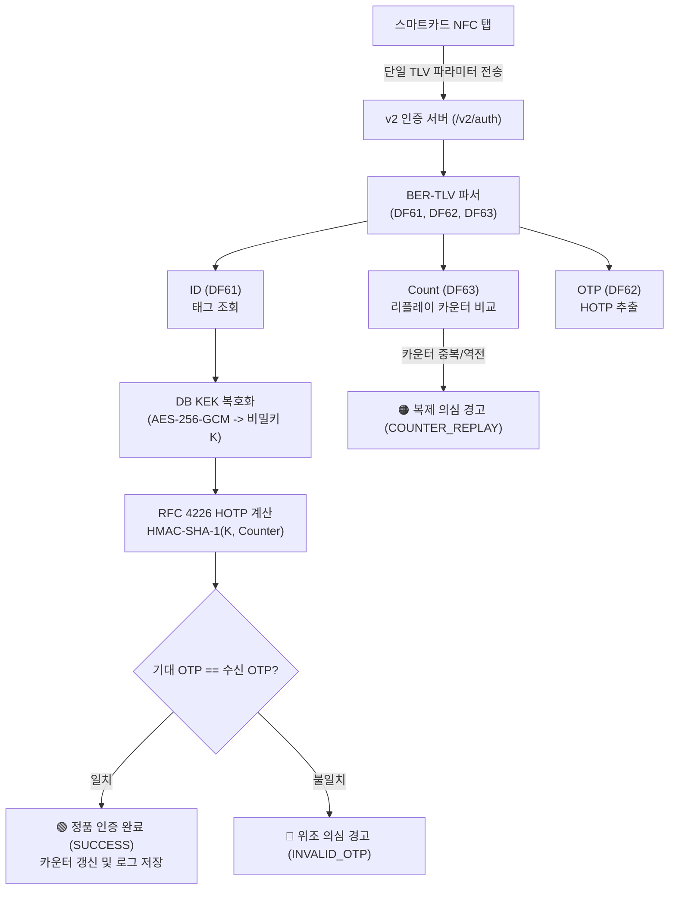

# NFC Authentication v2 보안 인증 규격서 (BER-TLV + RFC 4226 HOTP)

## 1. 개요 및 설계 배경

본 문서는 **NFC 스마트카드 및 보안 태그의 v2 정품 인증 엔드포인트 (`/v2/auth` 또는 `/functions/v1/auth`)**에 대한 기술 사양서입니다.

기존 v1 버전이 NXP NTAG 424 DNA 호환의 대칭키 CMAC 동적 서명(`uid`, `cnt`, `mac`, `kid` 4개 파라미터 분리) 방식을 사용한 것에 반해, **v2 버전은 단 하나의 파라미터에 스마트카드 표준 BER-TLV(Tag-Length-Value) 구조로 데이터를 압축 인코딩**하고, IETF 표준 **RFC 4226 HOTP (HMAC-based One-Time Password)** 알고리즘을 적용하여 보안성과 표준 적합성을 대폭 강화하였습니다.



---

## 2. API 엔드포인트 사양

- **Supabase Edge Function 엔드포인트**: `https://<project-ref>.supabase.co/functions/v1/v2/auth` (또는 `/functions/v1/v2`, `/functions/v1/auth`)
- **로컬 / 프록시 엔드포인트**: `http://localhost:3000/functions/v2/auth` (또는 `/v2/auth`)
- **HTTP 메소드**: `GET` 및 `POST` 모두 지원
- **응답 형식**: JSON (`format=json` 또는 Header `Accept: application/json`), HTML (모바일 브라우저 직접 접속 시)

---

## 3. 단일 파라미터 BER-TLV 데이터 규격

v2 인증 엔드포인트에는 **오직 하나의 파라미터**만 전달됩니다. 이 파라미터 내부에는 ISO 7816-4 / EMV 규격의 BER-TLV 태그 3개가 순차적으로 인코딩되어 있습니다:

| 태그 (Tag) | 명칭 | 길이 (Length) | 데이터 형식 (Value) | 상세 설명 |
| :---: | :---: | :---: | :---: | :--- |
| **`DF61`** | **id** | 가변 (보통 7B = 14 Hex) | Hex 바이트열 | 스마트카드 하드웨어 고유 식별자 (UID, 예: `04DE5F1EACC040`) |
| **`DF62`** | **otp** | 가변 (보통 4B~6B) | ASCII 숫자 또는 바이너리 | RFC 4226 알고리즘에 의해 계산된 6자리(또는 8자리) 일회용 암호 |
| **`DF63`** | **count** | 가변 (1B ~ 4B) | Big-Endian 정수 바이트열 | 탭할 때마다 1씩 단조 증가하는 하드웨어 보안 카운터 |

### 3.1 BER-TLV 인코딩 구조
- **태그 (2 Bytes)**: `DF61`, `DF62`, `DF63` (스마트카드 Private Class 2바이트 태그)
- **길이 (1~2 Bytes)**:
  - `0x00` ~ `0x7F` (127바이트 이하): 1바이트 그대로 길이 표현 (예: `07` = 7바이트)
  - `0x80` 이상: `81 LL` (1바이트 추가 확장)
- **값 (Value)**: 각 데이터의 16진수 바이트열 (대문자 `UPPERCASE` 표준 준수)

### 3.2 페이로드 예시
```text
DF61 07 04DE5F1EACC040 DF62 06 323837303832 DF63 03 000001
```
- `DF61` (Tag) + `07` (Len 7B) + `04DE5F1EACC040` (Val: UID)
- `DF62` (Tag) + `06` (Len 6B) + `323837303832` (Val: ASCII "287082")
- `DF63` (Tag) + `03` (Len 3B) + `000001` (Val: Counter = 1)
- **압축된 최종 단일 파라미터 문자열**:
  ```text
  DF610704DE5F1EACC040DF6206323837303832DF6303000001
  ```

---

## 4. RFC 4226 HOTP 검증 알고리즘

서버는 데이터베이스에 안전하게 암호화(Envelope Encryption)된 해당 카드의 대칭키 $K$를 읽어와 다음과 같이 HOTP를 계산하고 검증합니다:

1. **카운터 버퍼 준비**:
   수신된 카운터 정수를 8바이트 Big-Endian 64비트 버퍼 $C$로 변환합니다:
   $$C = [0x00, 0x00, 0x00, 0x00, 0x00, 0x00, 0x00, 0x01]$$

2. **HMAC-SHA-1 해시 연산**:
   $$HS = \text{HMAC-SHA-1}(K, C) \quad (20 \text{ Bytes})$$

3. **Dynamic Truncation (동적 절단)**:
   - 오프셋 추출: $\text{Offset} = HS[19] \ \& \ 0x0F \quad (0 \sim 15)$
   - 31비트 이진 코드 추출:
     $$\text{BinCode} = ((HS[\text{Offset}] \ \& \ 0x7F) \ll 24) \ | \ ((HS[\text{Offset}+1] \ \& \ 0xFF) \ll 16) \ | \ ((HS[\text{Offset}+2] \ \& \ 0xFF) \ll 8) \ | \ (HS[\text{Offset}+3] \ \& \ 0xFF)$$

4. **모듈로 연산 및 6자리/8자리 OTP 도출**:
   $$\text{HOTP} = \text{BinCode} \pmod{10^6} \quad \rightarrow \quad 6\text{자리 문자열 (Zero-padding)}$$

5. **상수 시간 비교 (Constant-Time Verification)**:
   타이밍 공격(Timing Attack)을 방지하기 위해 `timingSafeEqual`을 사용하여 수신된 `otp`와 계산된 기대값을 비교합니다.

---

## 5. 리플레이 공격 차단 및 상태 전이

1. **카운터 검사**:
   $$\text{Counter}_{\text{received}} \le \text{Counter}_{\text{DB (last\_counter)}}$$
   위 조건이 참인 경우, 이전에 이미 사용된 일회용 카운터이므로 즉시 **`COUNTER_REPLAY` (HTTP 409)** 경고를 반환하고 트랜잭션을 중단합니다.
2. **원자적 카운터 갱신**:
   검증이 통과되면 PostgreSQL의 격리 트랜잭션(`FOR UPDATE`)을 통해 DB의 `last_counter`를 이번 카운터 값으로 업데이트하고 `total_scans`를 1 증가시킵니다.

---

## 6. 호출 및 연동 방법

### 6.1 HTTP GET 호출 (쿼리 파라미터 `data`)
```bash
curl "https://jklfqmbaubvnbrbuhzak.supabase.co/functions/v1/v2/auth?data=DF610704DE5F1EACC040DF6206323837303832DF6303000001&format=json"
```

### 6.2 HTTP POST 호출 (JSON Body)
```bash
curl -X POST "https://jklfqmbaubvnbrbuhzak.supabase.co/functions/v1/v2/auth" \
  -H "Content-Type: application/json" \
  -d '{
    "data": "DF610704DE5F1EACC040DF6206323837303832DF6303000001"
  }'
```

### 6.3 성공 응답 (HTTP 200 OK)
```json
{
  "version": "v2",
  "authType": "HOTP",
  "success": true,
  "resultCode": "SUCCESS",
  "uid": "04DE5F1EACC040",
  "counter": 1,
  "otp": "287082",
  "tagName": "NFC 보안 인증 테스트 태그",
  "totalScans": 1,
  "firstVerifiedAt": "2026-11-01T04:30:00.000Z",
  "productInfo": {
    "brand": "NFC Authentication",
    "model": "NFC Secure SmartCard",
    "serialNumber": "NFC-AUTH-0001"
  }
}
```

### 6.4 실패 응답 코드 일람
- `COUNTER_REPLAY` (409): 이전 카운터 재전송 감지 (복제 의심)
- `INVALID_OTP` (401): HOTP 비밀번호 불일치 (위조 의심)
- `TAG_NOT_FOUND` (404): DB에 등록되지 않은 UID
- `BAD_REQUEST` (400): TLV 데이터 누락 또는 포맷 오류
- `SERVER_ERROR` (500): 서버 내부 오류 또는 KEK 복호화 실패
